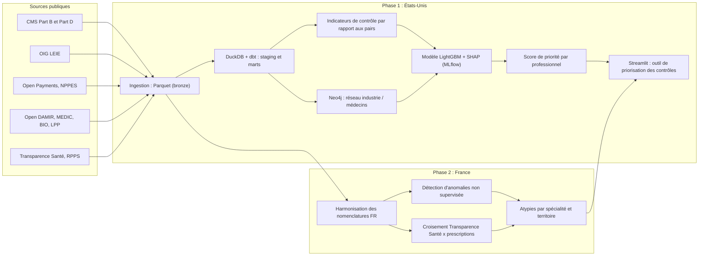

# Health Fraud Radar

**Détection des comportements de facturation atypiques chez les professionnels de santé : apprendre sur les données publiques américaines, transposer la méthode aux données ouvertes de l'Assurance maladie.**


---

## Sommaire

1. [723 millions d'euros](#723-millions-deuros)
2. [Pourquoi ce projet](#pourquoi-ce-projet)
3. [Problématique](#problématique)
4. [L'idée centrale : apprendre là où tout est public](#lidée-centrale--apprendre-là-où-tout-est-public)
5. [Objectifs](#objectifs)
6. [Données](#données)
7. [Architecture](#architecture)
8. [Stack technique](#stack-technique)
9. [Plan d'action](#plan-daction)
10. [Journal de bord : attendu vs réalisé](#journal-de-bord--attendu-vs-réalisé)
11. [Résultats](#résultats)
12. [Choix méthodologiques](#choix-méthodologiques)
13. [Limites connues et précautions éthiques](#limites-connues-et-précautions-éthiques)
14. [Installation et lancement](#installation-et-lancement)
15. [Structure du dépôt](#structure-du-dépôt)
16. [Sources](#sources)
17. [Auteur](#auteur)

---

## 723 millions d'euros

C'est le montant des fraudes que l'Assurance maladie a détectées et stoppées en **2025**, un record, en hausse de **15 %** sur un an. Et ce n'est qu'environ **un tiers** de la fraude réelle, que l'Assurance maladie estime autour de **2 milliards d'euros** par an.

Le chiffre le plus important n'est pas celui-là. C'est la répartition :

- les **professionnels de santé libéraux** (ou des escrocs se faisant passer pour tels) représentent **73 % du préjudice**, pour seulement **28 % des dossiers** ;
- les fraudes des **assurés** représentent plus de la moitié des dossiers, mais environ **16 % des montants** ;
- selon un rapport IGAS / IGF d'octobre 2025, **3 % des dossiers concentrent 60 % du préjudice total**, et ils concernent le plus souvent des professionnels de santé ;
- les **centres de santé** (dentaire, ophtalmologie notamment) arrivent en tête avec **138 millions d'euros** de fraudes stoppées en 2025, en hausse de **253 %** en un an.

L'Assurance maladie elle-même décrit une « industrialisation » de la fraude : moins de fraudeurs isolés et opportunistes, davantage de montages organisés, avec des facturations massives d'actes sur des périodes très courtes, parfois à partir de données de patients volées.

---

## Pourquoi ce projet

Pendant longtemps, le patient était un témoin naturel de ce qui était facturé en son nom : il payait, recevait une feuille de soins, voyait le montant.

Ce témoin a progressivement quitté la scène. Avec la télétransmission des feuilles de soins électroniques et la généralisation du tiers payant, la facture passe directement du professionnel à l'Assurance maladie. Le patient ne paie souvent plus rien sur place et ne regarde presque jamais le détail de ce qui a été remboursé. Un acte jamais réalisé, une séance comptée deux fois ou un appareillage surfacturé peuvent passer sans que personne côté patient ne s'en aperçoive.

La dématérialisation a rendu le système plus simple et plus rapide pour tout le monde, y compris pour ceux qui le détournent. **La surveillance ne peut donc plus reposer sur le patient : elle doit reposer sur les données.** Une facturation frauduleuse laisse des traces statistiques : des volumes impossibles pour un seul praticien, des montants très éloignés de ceux de ses pairs, des pics soudains, des profils de prescription inhabituels.

Ce projet construit la chaîne complète qui permet de repérer ces traces : ingestion de données publiques volumineuses, entrepôt de données, indicateurs de contrôle, modèle de détection et outil de priorisation pour un contrôleur.

---

## Problématique

> **À partir des seules données de facturation et de prescription, peut-on repérer automatiquement les professionnels de santé dont le comportement est suffisamment atypique pour justifier un contrôle, et classer ces cas par priorité ?**

Et, en corollaire :

> **Une méthode apprise sur un système de santé où les données sont publiques et nominatives peut-elle être transposée, même partiellement, aux données ouvertes françaises ?**

---

## L'idée centrale : apprendre là où tout est public

En France, les données de soins détaillées par professionnel sont dans le **SNDS** (Système national des données de santé), accessible uniquement dans le cadre de projets autorisés. Les données ouvertes de l'Assurance maladie sont, elles, **agrégées** (par spécialité, région, tranche d'âge). Il n'existe pas non plus de liste publique de professionnels sanctionnés pour fraude qui pourrait servir d'étiquette.

Aux États-Unis, la situation est très différente :

- l'agence fédérale **CMS** publie, pour **chaque médecin** identifié par son numéro NPI, les actes facturés à Medicare, leur volume et leur montant, ainsi que ses prescriptions ;
- l'**OIG** (Office of Inspector General) publie la **LEIE**, la liste des professionnels exclus des programmes fédéraux de santé, notamment pour fraude. Cette liste sert d'**étiquette** pour entraîner un modèle supervisé.

Le projet se déroule donc en deux temps :

1. **Phase 1 (États-Unis)** : construire, entraîner et évaluer un système de détection complet sur les données américaines, là où les étiquettes existent.
2. **Phase 2 (France)** : transposer ce qui peut l'être aux données ouvertes françaises : les indicateurs de contrôle les plus utiles, la comparaison aux pairs, la détection d'anomalies non supervisée et le croisement avec les liens d'intérêts publiés sur Transparence Santé.

---

## Objectifs

| # | Objectif | Comment le mesurer |
|---|----------|--------------------|
| 1 | Pipeline reproductible sur plusieurs dizaines de millions de lignes | Exécution complète via Airflow, tests de qualité au vert |
| 2 | Indicateurs de contrôle fondés sur la comparaison aux pairs | Rappel et précision des règles mesurés sur les étiquettes LEIE |
| 3 | Modèle supervisé de détection | PR-AUC, rappel dans le top 1 % des professionnels les mieux classés |
| 4 | Chaque signalement est explicable | Explication SHAP lisible pour chaque professionnel signalé |
| 5 | Outil de priorisation des contrôles | Application Streamlit fonctionnelle |
| 6 | (Phase 2) Transposition aux données françaises | Tableau des atypies par spécialité et territoire, croisement Transparence Santé documenté |

---

## Données

### États-Unis (phase 1)

| Source | Contenu | Rôle |
|--------|---------|------|
| [CMS Medicare Physician & Other Practitioners, by Provider and Service](https://data.cms.gov/provider-summary-by-type-of-service/medicare-physician-other-practitioners) | Actes facturés à Medicare par professionnel et par code d'acte : volumes, patients distincts, montants | Comportement de facturation |
| [CMS Medicare Part D Prescribers, by Provider and Drug](https://data.cms.gov/provider-summary-by-type-of-service/medicare-part-d-prescribers) | Prescriptions par professionnel et par médicament | Comportement de prescription |
| [OIG LEIE](https://oig.hhs.gov/exclusions/exclusions_list.asp) | Professionnels exclus des programmes fédéraux, avec date et motif d'exclusion | Étiquettes |
| [CMS Open Payments](https://openpaymentsdata.cms.gov/) | Paiements et avantages versés par l'industrie aux médecins | Liens d'intérêts |
| [NPPES (registre NPI)](https://download.cms.gov/nppes/NPI_Files.html) | Référentiel des professionnels : spécialité, adresse | Référentiel |

Le déséquilibre est extrême : selon la littérature, la proportion de professionnels étiquetés comme fraudeurs se situe autour de quelques centièmes de pourcent.

### France (phase 2)

| Source | Contenu | Rôle |
|--------|---------|------|
| Open DAMIR (Assurance maladie) | Dépenses de l'Assurance maladie, agrégées par prestation, spécialité, région | Dépenses par catégorie de professionnels |
| Open MEDIC, Open BIO, Open LPP (Assurance maladie) | Médicaments, actes de biologie et dispositifs remboursés, agrégés | Prescriptions et appareillages |
| [Transparence Santé](https://www.transparence.sante.gouv.fr/) | Liens d'intérêts nominatifs entre industrie et professionnels de santé | Équivalent français d'Open Payments |
| [Annuaire Santé (RPPS)](https://annuaire.sante.fr/) | Référentiel des professionnels de santé | Référentiel et densités par territoire |

Les fichiers de données ne sont pas versionnés dans ce dépôt (voir [Installation](#installation-et-lancement)).

---

## Architecture



L'orchestration de l'ensemble est assurée par **Airflow**, avec un DAG par source et un DAG de construction de l'entrepôt.

---

## Stack technique

| Domaine | Outils |
|---------|--------|
| Langages | Python, SQL |
| Stockage | Parquet, DuckDB, PostgreSQL (couche servie à l'application), Neo4j |
| Transformation | dbt, pandas |
| Orchestration | Apache Airflow |
| Qualité des données | Tests dbt |
| Machine learning | scikit-learn, LightGBM, Isolation Forest |
| Explicabilité | SHAP |
| Suivi des expériences | MLflow |
| Visualisation | Streamlit, Plotly |
| Industrialisation | Docker, docker-compose, Git, GitHub Actions |

DuckDB est privilégié pour la transformation : les fichiers CMS représentent plusieurs dizaines de millions de lignes par an, et DuckDB les traite directement depuis Parquet sur un ordinateur portable.

---

## Plan d'action

Le projet est découpé en deux phases. **La phase 1 constitue à elle seule un projet complet** ; la phase 2 transpose la démarche aux données françaises.

Légende : ⬜ à faire · 🟨 en cours · ✅ terminé

| Semaine | Thème | Livrable attendu | Statut |
|:-------:|-------|------------------|:------:|
| 1 | Mise en place et compréhension des données | Environnement Docker, notebook d'exploration des données CMS et LEIE | ⬜ |
| 2 | Entrepôt de données | Couches bronze, staging et marts avec tests dbt | ⬜ |
| 3 | Orchestration et indicateurs de contrôle | DAG Airflow, indicateurs par rapport aux pairs, baseline mesurée | ⬜ |
| 4 | Analyse de réseau | Graphe industrie / médecins dans Neo4j, features de réseau | ⬜ |
| 5 | Modélisation (1/2) | Table d'entraînement étiquetée, premier modèle | ⬜ |
| 6 | Modélisation (2/2) | Modèle optimisé, comparaison avec la baseline, SHAP | ⬜ |
| 7 | Outil de priorisation | Application Streamlit, README v1 | ⬜ |
| 8 | Données françaises | Ingestion et harmonisation des données ouvertes françaises | ⬜ |
| 9 | Transposition | Détection d'anomalies FR, croisement Transparence Santé | ⬜ |
| 10 | Industrialisation | Tests, CI, vidéo de démonstration, README final | ⬜ |

---

## Journal de bord : attendu vs réalisé

Cette section est mise à jour chaque semaine. Elle documente ce qui était prévu, ce qui a réellement été fait, et les décisions prises en cours de route.

### Semaine 1 : mise en place et compréhension des données

**Attendu**
- Créer le dépôt et le fichier `docker-compose.yml` (PostgreSQL, Airflow, Neo4j, MLflow).
- Télécharger une année de données CMS Part B et Part D, la LEIE et le référentiel NPPES.
- Explorer avec DuckDB : distribution des volumes et montants par spécialité, nombre de professionnels, codes d'actes les plus coûteux.
- Lire la documentation de la LEIE : motifs d'exclusion, dates, présence ou non du NPI.
- Mesurer la proportion de professionnels CMS retrouvés dans la LEIE.

**Réalisé**
- _À compléter_

**Difficultés et décisions**
- _À compléter_

---

### Semaine 2 : entrepôt de données

**Attendu**
- Scripts d'ingestion qui convertissent les fichiers sources en Parquet (couche bronze).
- Modèles dbt `staging` : typage, normalisation des NPI, nettoyage des spécialités.
- Modèles dbt `marts` : dimension professionnels, faits actes, faits prescriptions, agrégats annuels par professionnel.
- Tests dbt : unicité des NPI, montants positifs, cohérence entre volumes et nombre de patients.

**Réalisé**
- _À compléter_

**Difficultés et décisions**
- _À compléter_

---

### Semaine 3 : orchestration et indicateurs de contrôle

**Attendu**
- DAG Airflow qui reconstruit l'entrepôt de bout en bout.
- Indicateurs de contrôle calculés **par rapport aux pairs** (même spécialité, même État) :
    - volume d'actes par patient ;
    - montant facturé par patient ;
    - part des actes les plus coûteux dans l'activité ;
    - nombre de codes d'actes distincts ;
    - volume de prescriptions d'opioïdes ou de médicaments à fort risque de détournement.
- Score de règles simple (écarts robustes à la médiane des pairs) et mesure de la baseline sur les étiquettes LEIE.

**Réalisé**
- _À compléter_

**Difficultés et décisions**
- _À compléter_

---

### Semaine 4 : analyse de réseau

**Attendu**
- Chargement dans Neo4j du réseau entreprises de santé / médecins issu d'Open Payments (montants, nature des paiements).
- Features de réseau par médecin : montant total reçu, nombre d'entreprises payeuses, centralité, appartenance à des groupes très connectés.
- Mise en regard avec les prescriptions Part D des médicaments des mêmes entreprises.
- Export des features vers l'entrepôt.

**Réalisé**
- _À compléter_

**Difficultés et décisions**
- _À compléter_

---

### Semaine 5 : modélisation (1/2)

**Attendu**
- Construction des étiquettes : un professionnel est positif si son activité précède sa date d'exclusion LEIE, en écartant l'activité postérieure.
- Table d'entraînement : indicateurs de facturation, de prescription et de réseau.
- Découpage **par année** : entraînement sur les années anciennes, test sur l'année la plus récente.
- Premier modèle LightGBM, gestion du déséquilibre extrême des classes.
- Suivi des expériences dans MLflow.

**Réalisé**
- _À compléter_

**Difficultés et décisions**
- _À compléter_

---

### Semaine 6 : modélisation (2/2)

**Attendu**
- Optimisation des hyperparamètres.
- Comparaison avec la baseline de la semaine 3 : combien de professionnels exclus retrouve-t-on dans le top 1 % du classement ?
- Analyse par spécialité : où le modèle fonctionne bien, où il échoue.
- Explications SHAP globales et individuelles.
- Étude d'ablation : apport réel des features de réseau.
- Sélection des indicateurs les plus utiles, en vue de leur transposition en phase 2.

**Réalisé**
- _À compléter_

**Difficultés et décisions**
- _À compléter_

---

### Semaine 7 : outil de priorisation

**Attendu**
- Application Streamlit :
    - classement des professionnels par score, filtrable par spécialité et État ;
    - fiche professionnel : position par rapport aux pairs sur chaque indicateur ;
    - explication SHAP traduite en phrases lisibles (par exemple : « montant facturé par patient 4 fois supérieur à la médiane des pairs ») ;
    - mention explicite que le score mesure une atypie, pas une culpabilité.
- README v1 complet avec résultats chiffrés.
- **Jalon : phase 1 terminée et publiable.**

**Réalisé**
- _À compléter_

**Difficultés et décisions**
- _À compléter_

---

### Semaine 8 : données françaises

**Attendu**
- Ingestion d'Open DAMIR, Open MEDIC, Open BIO, Open LPP, Transparence Santé et RPPS.
- Harmonisation : spécialités, territoires, périodes.
- Ajout des sources françaises au DAG Airflow et aux tests dbt.
- Documentation de ce qui est transposable depuis la phase 1 et de ce qui ne l'est pas.

**Réalisé**
- _À compléter_

**Difficultés et décisions**
- _À compléter_

---

### Semaine 9 : transposition

**Attendu**
- Détection d'anomalies non supervisée (Isolation Forest, écarts robustes) sur les dépenses par spécialité, territoire et période.
- Rapprochement des dépenses avec la densité de professionnels (RPPS) pour repérer les territoires et catégories atypiques.
- Croisement Transparence Santé x prescriptions : les spécialités qui reçoivent le plus d'avantages de l'industrie prescrivent-elles davantage les produits concernés ?
- Comparaison avec les secteurs que l'Assurance maladie identifie elle-même comme les plus touchés (centres de santé, audioprothèse, transport sanitaire, soins infirmiers).
- Ajout d'une vue France dans l'application.

**Réalisé**
- _À compléter_

**Difficultés et décisions**
- _À compléter_

---

### Semaine 10 : industrialisation

**Attendu**
- Tests unitaires sur les fonctions d'indicateurs.
- CI GitHub Actions (lint, tests, compilation dbt).
- Vidéo de démonstration de 2 minutes.
- README final.

**Réalisé**
- _À compléter_

**Difficultés et décisions**
- _À compléter_

---

## Résultats

_Section complétée au fil du projet. Aucun chiffre n'est indiqué tant qu'il n'a pas été mesuré._

**Phase 1 : détection sur données américaines (année de test)**

| Approche | PR-AUC | Rappel dans le top 1 % | Précision dans le top 1 % |
|----------|:------:|:----------------------:|:-------------------------:|
| Indicateurs par rapport aux pairs | - | - | - |
| Modèle, facturation et prescription | - | - | - |
| Modèle, facturation, prescription et réseau | - | - | - |

**Phase 2 : transposition française**

| Analyse | Principal enseignement |
|---------|------------------------|
| Atypies par spécialité et territoire | - |
| Croisement Transparence Santé x prescriptions | - |
| Cohérence avec les secteurs identifiés par l'Assurance maladie | - |

---

## Choix méthodologiques

- **Comparaison aux pairs plutôt qu'aux valeurs absolues.** Un cardiologue et un infirmier n'ont pas le même profil de facturation. Chaque indicateur est donc exprimé par rapport aux professionnels de même spécialité et de même territoire.
- **Écarts robustes (médiane, écart absolu médian) plutôt que moyenne et écart-type.** Les distributions de montants sont très asymétriques, et les fraudeurs eux-mêmes tirent la moyenne vers le haut.
- **Découpage par année.** Le modèle apprend sur le passé et est évalué sur l'année suivante, comme il le serait en production.
- **Étiquettes datées.** Seule l'activité antérieure à l'exclusion est étiquetée positive, sinon le modèle apprendrait l'effet de la sanction plutôt que le comportement qui l'a précédée.
- **Métrique orientée contrôle : rappel dans le top 1 %.** Une équipe de contrôle a une capacité limitée. La vraie question est : parmi les dossiers qu'elle a le temps d'ouvrir, combien sont pertinents ?
- **Explicabilité systématique.** Un contrôleur doit savoir pourquoi un professionnel est signalé avant d'engager une procédure.

---

## Limites connues et précautions éthiques

- **Les étiquettes sont bruitées.** Une exclusion LEIE ne correspond pas toujours à une fraude à la facturation (elle peut suivre une condamnation, une perte de licence, etc.), et la grande majorité des fraudeurs ne sont jamais exclus. Les « négatifs » contiennent donc des fraudeurs non détectés.
- **La LEIE ne contient que les exclusions en vigueur.** Les professionnels réintégrés disparaissent de la liste, ce qui crée un biais dans les étiquettes historiques.
- **Les données françaises ouvertes sont agrégées.** Le projet ne permet pas, et ne cherche pas, à désigner un professionnel français en particulier. La phase 2 identifie des catégories et des territoires atypiques et démontre la méthode. Une application individuelle nécessiterait un accès au SNDS dans un cadre autorisé.
- **Un lien d'intérêts n'est pas une fraude.** Les avantages déclarés sur Transparence Santé ou Open Payments sont légaux et publics. Ils sont utilisés comme contexte, jamais comme preuve.
- **Un score d'atypie n'est pas une accusation.** Un professionnel peut être atypique pour des raisons légitimes (patientèle particulière, activité spécialisée, zone sous-dotée). L'outil sert à prioriser des vérifications humaines, pas à conclure.
- **Données publiques nominatives.** Bien que les données CMS soient publiques, l'application et ce README ne mettent en avant aucun professionnel nommément.

---

## Installation et lancement

_Instructions provisoires, mises à jour au fil du projet._

```bash
# 1. Cloner le dépôt
git clone https://github.com/roderick-darell/health-fraud-radar.git
cd health-fraud-radar

# 2. Télécharger les données sources (scripts fournis au fil du projet)
#    et les placer dans data/raw/

# 3. Lancer l'environnement
docker compose up -d

# 4. Accès aux services
#    Airflow   : http://localhost:8080
#    Neo4j     : http://localhost:7474
#    Streamlit : http://localhost:8501
#    MLflow    : http://localhost:5000
```

---

## Structure du dépôt

```
health-fraud-radar/
├── docker-compose.yml
├── data/                  # non versionné
│   ├── raw/
│   │   ├── us/
│   │   └── fr/
│   └── bronze/
├── notebooks/             # exploration
├── ingestion/             # téléchargement et conversion Parquet
│   ├── us/
│   └── fr/
├── dbt/                   # staging, marts, indicateurs, tests
├── airflow/
│   └── dags/
├── graph/                 # réseau industrie / médecins
├── ml/                    # étiquettes, entraînement, évaluation, SHAP
├── anomalies_fr/          # détection non supervisée sur données françaises
├── app/                   # application Streamlit
├── tests/
└── README.md
```

---

## Sources

Chiffres de la fraude à l'Assurance maladie (bilan 2025, publié au printemps 2026) :
- [L'Assurance maladie face à des fraudes toujours plus sophistiquées (La Gazette France / AFP)](https://www.lagazettefrance.fr/article/l-assurance-maladie-face-a-des-fraudes-toujours-plus-sophistiquees)
- [Fraude à l'Assurance maladie : les travailleurs indépendants en première ligne de la vigilance (AG2R La Mondiale)](https://www.ag2rlamondiale.fr/groupe/magazines/perspectives/societe/fraude-a-l-assurance-maladie-les-travailleurs-independants-en-premiere-ligne-de-la-vigilance)
- [Il faut prioriser davantage les contrôles des professionnels de santé (MoneyVox, rapport IGAS / IGF)](https://www.moneyvox.fr/votre-argent/actualites/110133/assurance-maladie-il-faut-prioriser-davantage-les-controles-des-professionnels-de-sante-plutot-que-sur-les-particuliers)

Détection de fraude Medicare à partir des données CMS et de la LEIE :
- Herland, Khoshgoftaar, Bauder, *Big Data fraud detection using multiple Medicare data sources*, Journal of Big Data, 2018.
- [OIG, LEIE Downloadable Databases](https://oig.hhs.gov/exclusions/exclusions_list.asp)

---

## Auteur

**Darell Roderick Tchinde**
Étudiant en Master Informatique à l'Université de Lille, à la recherche d'une alternance en data / IA.

- Portfolio : [roderick-darell.github.io](https://roderick-darell.github.io)
- GitHub : [github.com/roderick-darell](https://github.com/roderick-darell)
